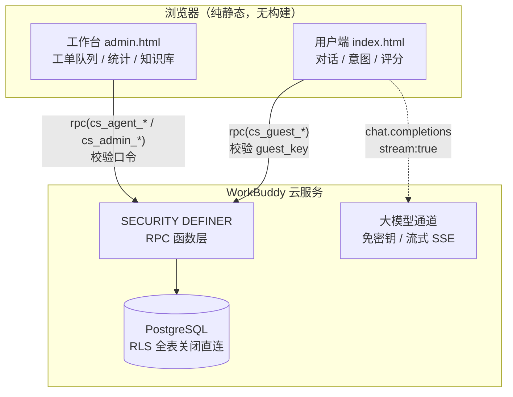

# 哭包 · 智能客服 Agent

[](https://github.com/cry-88/kubao-support-agent/actions/workflows/deploy-pages.yml)
[](LICENSE)

一个可以直接上线的**在线智能客服 Web 应用**：多轮对话、FAQ 知识库检索、意图识别、自动转人工、坐席工单队列、长会话摘要、管理后台与满意度统计。

无需自建服务器与 API Key —— 数据持久化、大模型调用全部走 WorkBuddy 云服务，前端为纯静态站点，CDN 加载 SDK，零构建。

> [!IMPORTANT]
> **部署后第一件事：修改管理员口令。**
> [`schema.sql`](schema.sql) 里的管理员口令是占位符 `CHANGE-ME-BEFORE-DEPLOY`，坐席口令是 `CHANGE-ME-1` / `CHANGE-ME-2`。
> 建库完成后必须立刻在数据库中改成你自己的强口令 —— 否则任何人都能凭占位符进入工作台。
> 修改方式见下方 [配置说明](#配置说明)。

---

## 目录

- [功能特性](#功能特性)
- [系统架构](#系统架构)
- [技术栈](#技术栈)
- [目录结构](#目录结构)
- [数据模型](#数据模型)
- [服务端接口（RPC）](#服务端接口rpc)
- [安全模型](#安全模型)
- [本地运行](#本地运行)
- [部署](#部署)
- [配置说明](#配置说明)
- [已知限制与路线图](#已知限制与路线图)

---

## 功能特性

### 用户端（`index.html`）

| 功能 | 说明 |
|---|---|
| 多轮对话 | 携带最近 10 条上下文，流式输出，可随时停止 |
| 长会话摘要 | 消息超过 12 条后自动把前文压缩成 200 字摘要，后续轮次用「摘要 + 最近 6 条」，聊再久也不丢关键信息 |
| 意图识别 | 关键词规则优先，置信度不足时调用大模型做 JSON 分类，实时显示「退款 / 查询订单 / 技术支持」标签 |
| FAQ 检索 | 关键词命中长度 + 问题二元组重合度打分，Top3 注入提示词，气泡上标注「FAQ 命中 N 条」 |
| 订单实时查询 | 正则提取订单号后查服务端真实数据再回答，避免模型编造物流与金额 |
| 自动转人工 | 用户说「转人工 / 投诉」立即转接；连续两轮无法识别意图也自动转接 |
| 非工作时间兜底 | 22:00–9:00 转人工时提示留言，手机号 / 邮箱落库供次日跟进 |
| 人工接入实时反馈 | 坐席接入后 4 秒内显示「小美 已接入，正在为您处理」+ 等待计时 |
| 满意度评价 | 1–5 星 + 留言，评价写入云端并计入后台统计 |
| 发送限流 | 前端 1 秒间隔 / 每分钟 10 条，服务端硬限制每分钟 12 条 |

### 坐席端（`admin.html` → 工单队列）

- **队列排序**：待接入工单按等待时长倒序，最久的排最前；满 3 分钟标黄、满 10 分钟标红
- **认领锁定**：点「接入」即锁定给自己，其他坐席不可重复接入
- **回复署名**：坐席消息带工号名字，用户端显示「人工客服 · 小美」
- **释放 / 解决**：处理不完可退回队列，处理完标记解决并触发满意度评价
- **实时指标**：待接入量、我处理中、超时工单、今日已解决，10 秒自动刷新

### 管理端（`admin.html` → 数据概览 / 对话记录 / 知识库 / 知识缺口）

- **数据概览**：累计会话 / 消息 / 平均满意度 / 好评率 / 待人工处理，满意度分布、意图分布、近 14 天趋势
- **对话记录**：按状态筛选、分页、完整消息流（含联系方式与摘要）、人工回复、导出 CSV
- **知识库**：FAQ 增删改查，保存后前台即时生效
- **知识缺口**：统计近 30 天 FAQ 未命中的提问并按次数排序，一键「转为 FAQ」补进知识库 —— 形成知识闭环

---

## 系统架构



**关键设计**：前端不直连数据表。除 FAQ 为公开只读外，所有业务表都开启 RLS 且**不建任何策略**，匿名身份查询恒为 0 行；一切读写都经过服务端函数，函数内部校验访客密钥或坐席口令后才落库。

---

## 技术栈

- **前端**：原生 HTML + CSS + JavaScript（单应用结构，无 monorepo、无框架、无打包）
- **云 SDK**：`@tencent-ai/workbuddy-cloud-sdk`。运行时通过 CDN 加载全局 `WorkBuddyCloud`，`package.json` 仅用于记录依赖版本，**`npm install` 不是必需的**
- **数据库**：托管 PostgreSQL + Row Level Security
- **模型**：平台免密钥大模型通道，仅支持流式（`stream: true`）

---

## 目录结构

```
smart-support-agent/
├── index.html            # 用户端聊天页
├── admin.html            # 坐席 / 管理后台（按口令区分角色）
├── package.json          # 依赖记录 + start 脚本（node_modules 不入库）
├── server.js             # 零依赖静态服务器：本地预览 / 部署启动入口
├── assets/
│   ├── config.js         # 云服务公开配置 + 客户端初始化 + RPC 解包
│   ├── kb.js             # 意图规则、FAQ 检索、提示词构造
│   ├── app.js            # 聊天页逻辑：对话、流式、摘要、转人工、评分
│   ├── admin.js          # 后台逻辑：队列、认领、统计、知识库、导出
│   ├── styles.css        # 通用样式
│   └── admin.css         # 后台图表与队列样式
├── .github/workflows/
│   └── deploy-pages.yml  # CI：语法检查 + 密钥扫描 + Pages 发布
├── .gitignore
├── LICENSE               # MIT
├── schema.sql            # 建表 + RLS + 28 个 RPC 函数 + 种子数据
└── README.md
```

---

## 数据模型

| 表 | 用途 | 访问方式 |
|---|---|---|
| `cs_conversations` | 会话主表：状态、意图、满意度、坐席、摘要 | 仅函数 |
| `cs_messages` | 消息：`user` / `assistant` / `agent` / `system` | 仅函数 |
| `cs_faqs` | FAQ 知识库（问题、答案、分类、关键词、优先级） | 公开只读 + 管理员写 |
| `cs_orders` | 演示订单数据 | 仅 `cs_lookup_order` |
| `cs_agents` | 坐席账号（姓名、工号口令、状态） | 仅函数 |
| `cs_settings` | 服务端配置（管理员口令等） | 仅函数 |

会话状态机：`active`（智能应答）→ `handoff`（待人工 / 人工处理中）→ `closed`（已结束并评价）。

---

## 服务端接口（RPC）

所有函数均为 `SECURITY DEFINER`，返回统一结构 `{ ok: boolean, ... }`。

**访客侧**（校验 `guest_key`）

| 函数 | 说明 |
|---|---|
| `cs_guest_start` | 开启新会话并写入欢迎语 |
| `cs_guest_list` | 本机访客的会话列表 |
| `cs_guest_poll` | 增量拉取消息 + 会话状态 + 坐席 + 摘要 |
| `cs_guest_append` | 写入消息（含每分钟 12 条限流） |
| `cs_guest_update` | 变更会话状态 / 意图 |
| `cs_guest_rate` | 提交满意度与留言 |
| `cs_guest_contact` | 留下联系方式 |
| `cs_guest_summary_save` | 保存长会话摘要 |
| `cs_lookup_order` | 按订单号查询订单状态 |

**坐席侧**（校验坐席口令）

| 函数 | 说明 |
|---|---|
| `cs_console_login` | 统一登录，返回角色（管理员 / 坐席） |
| `cs_agent_queue` | 待接入 / 我处理中 / 他人处理中 / 今日已解决 |
| `cs_agent_claim` / `cs_agent_release` | 认领 / 释放工单（冲突返回 `claimed_by_other`） |
| `cs_agent_messages` | 会话详情（含摘要、联系方式） |
| `cs_agent_reply` / `cs_agent_resolve` | 人工回复 / 标记解决 |

**管理侧**（校验管理员口令）

`cs_admin_stats`、`cs_admin_conversations`、`cs_admin_messages`、`cs_admin_reply`、`cs_admin_resolve`、`cs_admin_faq_list` / `save` / `delete`、`cs_admin_gaps`（知识缺口）、`cs_admin_export`（导出）

---

## 安全模型

| 层次 | 做法 |
|---|---|
| 前端 | 只持有 `endpoint` / `publishableKey` 等公开配置；不含任何长期密钥 |
| 数据库 | 业务表 `ENABLE ROW LEVEL SECURITY` 且零策略 —— 匿名与登录用户直连均被拒绝 |
| 函数层 | `SECURITY DEFINER` + 强制口令校验；访客数据按 `guest_key` 隔离，换密钥查不到他人会话 |
| 模型 | 平台免密钥通道，不暴露上游凭证；模型输出按纯文本渲染，不执行、不拼 SQL |
| 输入 | 系统提示与用户输入分离（用户消息进 `user` 角色，不进 `system`），降低提示注入风险 |

> 仓库中不包含任何口令、密钥或 `.env`。管理员口令与坐席工号由数据库配置，首次部署后请自行设置并定期更换。

---

## 本地运行

```bash
npm start          # 等价于 node server.js，也可直接 python -m http.server 8080
# 打开 http://localhost:8080
```

> ⚠️ 云服务按**来源域名精确校验**，`localhost` 无法完成数据与大模型调用。本地只用于看页面样式，功能请在上线域名验证。

---

## 部署

任意静态托管即可（本仓库无构建步骤）：

1. 在云数据库执行 [`schema.sql`](schema.sql)：建表、开启 RLS、创建 28 个 RPC 函数并写入 FAQ 与演示订单种子数据
2. 把 `assets/config.js` 中的 `CLOUD_PUBLIC_CONFIG` 换成你自己的云服务环境（`endpoint` / `publishableKey` / `oauthRelayBaseUrl`）
3. 把 `cs_settings.admin_code` 与 `cs_agents.code` 的占位口令改成真实口令
4. 将目录作为静态站点发布，入口页 `index.html`

`config.js` 里的 `publishableKey` 只标识应用、不含权限，服务端仍会做 Origin 校验，可安全置于前端。

---

## 自动部署（GitHub Actions）

推送到 `main` 会自动执行 [`.github/workflows/deploy-pages.yml`](.github/workflows/deploy-pages.yml)：

1. **检查阶段** — `node --check` 校验全部前端脚本；核对入口文件是否齐全；扫描常见密钥 / 私钥特征（命中即失败）；校验 `schema.sql` 的表与函数数量
2. **发布阶段** — 打包仓库根目录，发布到 GitHub Pages

启用方式：仓库 **Settings → Pages → Build and deployment → Source** 选择 **GitHub Actions**，之后 push 或手动 **Run workflow** 即可。

> [!WARNING]
> **Pages 上页面能打开，但业务不可用。** 云服务按来源域名做精确校验，`*.github.io` 与已登记的应用域名不同，数据读写与大模型调用都会被拒绝。
> 想让 Pages 版本完整可用，需把 `assets/config.js` 换成允许该域名的云服务环境；否则请以正式上线域名为准。

---

## 配置说明

| 项 | 位置 | 说明 |
|---|---|---|
| 管理员口令 | `cs_settings.admin_code` | `UPDATE cs_settings SET value='新口令' WHERE key='admin_code';` |
| 坐席账号 | `cs_agents` | `INSERT INTO cs_agents (name, code) VALUES ('姓名','工号口令');` |
| 营业时间 | `assets/app.js` → `isBusinessHours()` | 默认 9:00–21:00（UTC+8） |
| 摘要阈值 | `assets/app.js` → `SUMMARY_AFTER` / `SUMMARY_STEP` | 默认 12 条触发、每 6 条重算 |
| 限流阈值 | 前端 `RATE` + 服务端 `cs_guest_append` | 前端 10/分钟，服务端 12/分钟 |

---

## 已知限制与路线图

**当前限制**

- 访客身份基于浏览器 `localStorage` 的随机密钥，清缓存或换设备会丢失历史
- 摘要是全量重压，超长会话仍有优化空间（可改为旧摘要 + 新增消息的增量合并）
- 限流以单浏览器为主，分布式刷量需在网关层加固

**后续可做**

- [ ] 超时无人接入的自动告警（>5 分钟推送管理员）
- [ ] 截图上传，技术支持场景直接看报错画面
- [ ] 工单质检评分与首响时长、解决率等运营指标
- [ ] 会话码跨设备续聊
- [ ] 敏感信息（手机号、证件号）进模型前脱敏

---

## License

[MIT](LICENSE) © 2026 cry-88
