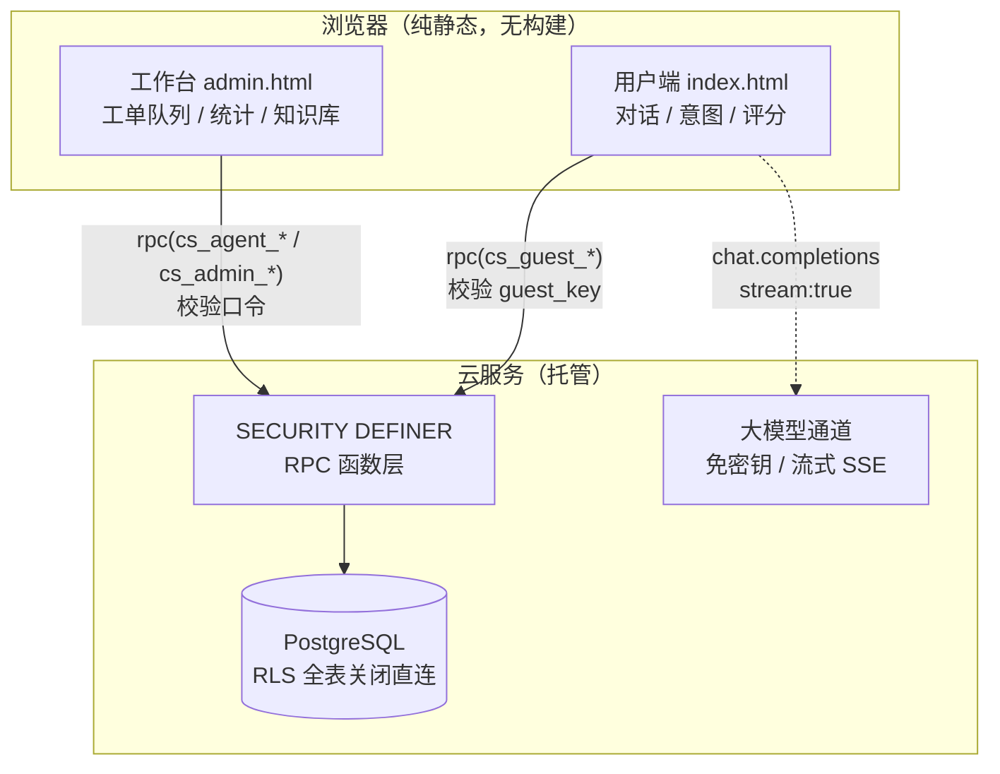

# 哭包 · 智能客服 Agent

[](https://github.com/cry-88/kubao-support-agent/actions/workflows/deploy-pages.yml)
[](LICENSE)

一个可以直接上线的**在线智能客服 Web 应用**：多轮对话、FAQ 知识库检索、意图识别、自动转人工、坐席工单队列、长会话摘要、管理后台与满意度统计。

单应用结构，没有 monorepo、没有 `packages/` 子包、没有打包构建；数据持久化与大模型调用全部走云端，前端是纯静态页面。

> [!IMPORTANT]
> **部署后第一件事：修改管理员口令。**
> [`schema.sql`](schema.sql) 里的管理员口令是占位符 `CHANGE-ME-BEFORE-DEPLOY`，坐席口令是 `CHANGE-ME-1` / `CHANGE-ME-2`。
> 建库完成后必须立刻在数据库中改成你自己的强口令 —— 否则任何人都能凭占位符进入工作台。
> 修改方式见 [配置说明](#配置说明)。

---

## 当前版本：本地后端模式（开箱即跑）

本仓库当前分支已改为**零依赖本地后端**，不再依赖云服务即可完整运行全部功能（对话、FAQ 检索、意图识别、订单查询、转人工、坐席工单、后台统计、知识缺口、CSV 导出）：

```bash
node server.js          # 或 npm start
# 打开 http://localhost:8080       用户端
# 打开 http://localhost:8080/admin.html   坐席 / 管理后台
```

默认口令（首次启动写入 `data/store.json`，请立即修改）：

| 角色 | 口令 |
| --- | --- |
| 管理员 | `kubao-admin-2026` |
| 坐席 · 客服A | `kubao-agent-1` |
| 坐席 · 客服B | `kubao-agent-2` |

改口令的两种方式：改 `data/store.json` 里 `settings[0].value` / `agents[].code`，或删除该文件后用环境变量 `CS_ADMIN_CODE`、`CS_AGENT_CODE_1/2` 重新初始化。

替换关系：

| 原实现 | 现实现 |
| --- | --- |
| `assets/config.js` 连 `@tencent-ai/workbuddy-cloud-sdk` | 同文件内的轻量客户端，走本项目 `/api/*`（接口形状不变，`app.js` / `admin.js` 未改动） |
| PostgreSQL + 28 个 `SECURITY DEFINER` 函数 | `server/rpc.js` 逐个还原同名函数与返回结构，数据落 `data/store.json` |
| 云端大模型（免密钥流式通道） | `server/reply.js` 确定性应答引擎：解析前端已检索好的 FAQ 与订单事实后作答，不编造数字，同样支持 SSE 流式与「停止生成」 |
| `schema.sql` 一次建库 | `server/store.js` 首次启动按同样种子数据（12 条 FAQ / 3 个演示订单）初始化 |

> 需要真实大模型改写措辞、或需要跨设备共享数据时，再按下面的云服务部署步骤接回 PostgreSQL 与模型通道即可；`schema.sql` 与前端业务逻辑都还保留着。

---

## 目录

- [功能列表](#功能列表)
- [系统架构](#系统架构)
- [技术栈](#技术栈)
- [目录结构](#目录结构)
- [部署步骤](#部署步骤)
- [环境变量](#环境变量)
- [界面截图](#界面截图)
- [数据模型](#数据模型)
- [服务端接口（RPC）](#服务端接口rpc)
- [安全模型](#安全模型)
- [配置说明](#配置说明)
- [已知限制与路线图](#已知限制与路线图)

---

## 功能列表

### 用户端（`index.html`）

| 功能 | 说明 |
|---|---|
| 多轮对话 | 携带最近 10 条上下文，流式输出，可随时「停止生成」 |
| 长会话摘要 | 有效消息超过 12 条后自动把前文压缩成 200 字摘要，后续轮次用「摘要 + 最近 6 条」，聊再久也不丢关键信息 |
| 意图识别 | 关键词规则优先，置信度不足时调用大模型做 JSON 分类，实时显示「退款 / 查询订单 / 技术支持」标签 |
| FAQ 检索 | 关键词命中长度 + 问题二元组重合度打分，Top3 注入提示词，气泡标注「FAQ 命中 N 条」 |
| 订单实时查询 | 正则提取订单号后查服务端真实数据再回答，避免模型编造物流与金额 |
| 自动转人工 | 「转人工」「投诉」立即转接；连续两轮无法识别意图也会自动转接 |
| 非工作时间兜底 | 22:00–9:00 转人工时提示留言，手机号 / 邮箱落库供次日跟进 |
| 人工接入实时反馈 | 坐席接入后 4 秒内显示「小美 已接入，正在为您处理」+ 等待计时 |
| 满意度评价 | 1–5 星 + 留言，写入云端并计入统计 |
| 发送限流 | 前端 1 秒间隔 / 每分钟 10 条，服务端硬限制每分钟 12 条 |
| 历史会话 | 本机访客可回看全部历史会话（按 `guest_key` 隔离） |

### 坐席端（`admin.html` → 工单队列）

- **队列排序**：待接入工单按等待时长倒序，满 3 分钟标黄、满 10 分钟标红
- **认领锁定**：点「接入」锁定给自己，其他坐席不可重复接入
- **回复署名**：坐席消息带工号名字，用户端显示「人工客服 · 小美」
- **释放 / 解决**：处理不完退回队列；处理完结并触发满意度评价
- **实时指标**：待接入量、我处理中、超时工单、今日已解决，10 秒自动刷新

### 管理端（`admin.html`）

- **数据概览**：累计会话 / 消息 / 平均满意度 / 好评率 / 待人工处理，满意度分布、意图分布、近 14 天趋势
- **对话记录**：状态筛选、分页、完整消息流（含联系方式与摘要）、人工回复、**导出 CSV**
- **知识库**：FAQ 增删改查，保存后前台即时生效
- **知识缺口**：统计近 30 天 FAQ 未命中的提问并按次数排序，一键「转为 FAQ」补进知识库

---

## 系统架构



**关键设计**：前端不直连数据表。除 FAQ 为公开只读外，所有业务表都开启 RLS 且**不建任何策略**，匿名身份查询恒为 0 行；一切读写都经过服务端函数，函数内部校验访客密钥或坐席口令后才落库。

---

## 技术栈

| 层 | 选型 | 说明 |
|---|---|---|
| 前端 | 原生 HTML + CSS + JavaScript | 无框架、无打包、无运行时依赖，改完刷新即生效 |
| 云 SDK | `@tencent-ai/workbuddy-cloud-sdk` | 运行时从 CDN 加载全局 `WorkBuddyCloud`；`package.json` 仅记录依赖版本，`npm install` 非必需 |
| 数据 | PostgreSQL + RLS | 行级安全 + `SECURITY DEFINER` 函数作为唯一入口 |
| 模型 | 平台免密钥通道 | 仅支持流式（`stream: true`），前端不持有任何密钥 |
| 静态服务 | `server.js`（Node，零依赖） | 本地预览与平台部署共用，监听 `$PORT` |
| CI/CD | GitHub Actions | 语法检查 + 密钥扫描 + Pages 发布 |
| 宿主 | 静态托管 / Node 服务 | 单端口 HTTP，任意静态托管均可 |

---

## 目录结构

```
kubao-support-agent/
├── index.html            # 用户端聊天页
├── admin.html            # 坐席 / 管理后台（按口令区分角色）
├── 404.html              # 404 兜底：3 秒回首页，兼容子路径部署
├── server.js             # 零依赖静态服务器：本地预览 / 部署启动入口
├── package.json          # 依赖记录 + start 脚本（单应用，无 packages 子包）
├── .env.example          # 环境变量占位模板（不含真实密钥）
├── .gitignore
├── LICENSE               # MIT
├── schema.sql            # 一次性初始化脚本：建表 + RLS + 28 个 RPC 函数 + 种子数据
├── assets/
│   ├── config.js         # 云服务公开配置 + 客户端初始化 + RPC 解包
│   ├── kb.js             # 意图规则、FAQ 检索、提示词构造
│   ├── app.js            # 聊天页逻辑：对话、流式、摘要、转人工、评分
│   ├── admin.js          # 后台逻辑：队列、认领、统计、知识库、导出
│   ├── styles.css        # 通用样式
│   └── admin.css         # 后台图表与队列样式
├── docs/screenshots/     # 界面截图（见「界面截图」）
└── .github/workflows/
    └── deploy-pages.yml  # CI：语法检查 + 密钥扫描 + Pages 发布
```

---

## 部署步骤

### 第 1 步：初始化数据库

在云数据库 SQL 控制台执行 [`schema.sql`](schema.sql)。它会创建 7 张表、开启 RLS、创建 28 个 RPC 函数，并写入 FAQ 与演示订单种子数据。

> [!WARNING]
> **`schema.sql` 是一次性初始化脚本，请当作「空库安装包」使用。**
>
> - **不做拆分**：表、RLS、函数、种子数据都在这一个文件里，按顺序执行才不会出现「函数引用了还不存在的表」
> - **面向空库**：脚本假设 `public` schema 中没有同名 `cs_` 对象
> - **重复执行有副作用**：表与函数因 `CREATE ... IF NOT EXISTS` / `CREATE OR REPLACE` 不会报错，但 **FAQ 与演示订单会重复插入**（没有唯一约束），导致知识库出现重复条目、命中打分被稀释
> - **口令不会被覆盖**：`admin_code` 使用 `ON CONFLICT DO NOTHING`，重跑不会把真实口令改回占位符
> - **务必先备份**：在已有业务数据的库上执行前先做快照，不要直接在生产库试跑

如需二次执行，先清理种子表：

```sql
DELETE FROM cs_faqs;
DELETE FROM cs_orders;
```

### 第 2 步：配置后端域名（endpoint）

`assets/config.js` 里的 `endpoint` 既是**数据面地址**，也是云服务的**来源校验基准**：

```js
window.CLOUD_PUBLIC_CONFIG = {
  resourceId: 'wbcs_xxx',
  endpoint: 'https://你的应用域名',   // ← 必须是本应用发布出来的域名
  oauthRelayBaseUrl: 'https://www.workbuddy.cn/v2/as/genie-baas/oauth',
  publishableKey: 'wbpk_xxx',
};
```

**正确取值的顺序不能反：**

1. 在平台开通云服务，拿到 `publicConfig` 的四个字段（`endpoint` / `publishableKey` / `oauthRelayBaseUrl` / `resourceId`）
2. 把项目发布到云托管，得到形如 `https://xxx.app.workbuddy.host` 的域名
3. 把第 1 步的 `endpoint` 回填进 `config.js`，它必须与第 2 步的域名**完全一致**（含 `https://`，不带路径与查询串）

**三个常见坑：**

- 填成 `https://cry-88.github.io/...` → 必然 403，Pages 域名不在白名单
- 填成别的应用的域名 → 数据读写会串到别人的环境
- 换了发布域名但没同步 `config.js` → 页面能打开，但所有请求被拒

`publishableKey` 只标识应用、本身不带权限（服务端按来源域名精确校验），可以安全地放在前端；**任何情况下都不要把长期密钥写进仓库或 `.env.example`**。

### 第 3 步：本地预览

```bash
npm start            # 等价于 node server.js
# 打开 http://localhost:8080
```

> [!NOTE]
> 云服务按来源域名精确校验，`localhost` 无法完成数据与大模型调用。本地只用来看样式与结构，功能请在上线域名验证。

### 第 4 步：修改口令

建库后立刻改掉占位口令，否则工作台是敞开的：

```sql
UPDATE cs_settings SET value = '你的强口令' WHERE key = 'admin_code';

INSERT INTO cs_agents (name, code) VALUES ('你的客服', '你的工号口令');
```

### 第 5 步：发布上线

**A. 发布到云托管（推荐，功能完整）**

把目录作为静态站点 / Node 服务发布，入口 `index.html`，服务监听 `$PORT` 并绑定 `0.0.0.0`（`server.js` 已实现）。发布后拿到形如 `https://xxx.app.workbuddy.host` 的域名，并把该域名回填到 `config.js` 的 `endpoint`。

**B. 发布到 GitHub Pages（自动，仅静态预览）**

1. 仓库 **Settings → Pages → Build and deployment → Source** 选择 **GitHub Actions**
2. push 到 `main`，或到 **Actions → Deploy to GitHub Pages → Run workflow** 手动触发
3. 站点地址：`https://cry-88.github.io/kubao-support-agent/`

> [!WARNING]
> **Pages 版本只做静态预览，不跑任何业务。** 云服务按来源域名精确校验，`*.github.io` 与已登记的应用域名不同，数据读写与大模型调用都会被拒绝。
> 代码已内置**静态预览模式**：检测到 `*.github.io` 时不发起任何云端请求，禁用输入框与登录按钮，页面顶部提示「静态预览模式」。想看真实对话、后台与统计，必须访问云托管域名。

---

## 环境变量

复制 [`.env.example`](.env.example) 为 `.env` 后填写。`.env` 已被 `.gitignore` 忽略，**不要提交真实值**。

| 变量 | 用途 | 是否必需 |
|---|---|---|
| `CLOUD_ENDPOINT` | 数据面地址，写入 `config.js` | 是 |
| `CLOUD_PUBLISHABLE_KEY` | 应用标识键（无权限，可公开） | 是 |
| `CLOUD_OAUTH_RELAY_BASE_URL` | 微信扫码 / WorkBuddy 账号登录用 | 否 |
| `CLOUD_RESOURCE_ID` | 云服务资源 ID | 是 |
| `PORT` | 静态服务器端口，`server.js` 读取 | 否（默认 8080） |

> [!NOTE]
> 本项目是纯静态前端，页面运行时**不读取 `.env`**。这些变量用于「部署前替换 `config.js`」「本地/CI 启动参数」以及「初始化数据库时人工设置的口令备忘」。数据库口令只存在云端 `cs_settings` / `cs_agents` 表里，不进代码。

---

## 界面截图

截图统一放在 [`docs/screenshots/`](docs/screenshots/)，文件名与页面一一对应：

| 文件 | 对应页面 | 建议内容 |
|---|---|---|
| `01-chat.png` | `index.html` | 用户端对话，含意图标签、FAQ 命中标记、停止生成按钮 |
| `02-handoff.png` | `index.html` | 转人工等待态（含等待计时）与坐席已接入态 |
| `03-rating.png` | `index.html` | 结束咨询后的 1–5 星评价卡 |
| `04-queue.png` | `admin.html` → 工单队列 | 待接入 / 我处理中 / 超时标红 |
| `05-overview.png` | `admin.html` → 数据概览 | 满意度分布、意图分布、14 天趋势 |
| `06-faq.png` | `admin.html` → 知识库 | FAQ 增删改表单与列表 |

截图规范：1440×900 或 1280×800，裁掉浏览器边框，PNG 格式，单张小于 500KB。放好后把上面的文件引用替换成图片链接，README 会自动展示。

---

## 数据模型

| 表 | 用途 | 访问方式 |
|---|---|---|
| `cs_conversations` | 会话主表：状态、意图、满意度、坐席、摘要 | 仅函数 |
| `cs_messages` | 消息：`user` / `assistant` / `agent` / `system` | 仅函数 |
| `cs_faqs` | FAQ 知识库（问题、答案、分类、关键词、优先级） | 公开只读 + 管理员写 |
| `cs_orders` | 演示订单数据 | 仅 `cs_lookup_order` |
| `cs_agents` | 坐席账号（姓名、工号口令、状态） | 仅函数 |
| `cs_settings` | 服务端配置（管理员口令等） | 仅函数 |
| `cs_login_attempts` | 登录失败审计，用于防爆破 | 仅函数 |

会话状态机：`active`（智能应答）→ `handoff`（待人工 / 人工处理中）→ `closed`（已结束并评价）。

---

## 服务端接口（RPC）

所有函数均为 `SECURITY DEFINER`，返回统一结构 `{ ok: boolean, ... }`。

| 分组 | 函数 |
|---|---|
| 访客侧（校验 `guest_key`） | `cs_guest_start` / `list` / `messages` / `poll` / `append` / `update` / `rate` / `contact` / `summary_save` |
| 工具 | `cs_lookup_order` |
| 坐席侧（校验坐席口令） | `cs_console_login`、`cs_operator`、`cs_agent_queue` / `claim` / `release` / `messages` / `reply` / `resolve` |
| 管理侧（校验管理员口令） | `cs_admin_stats` / `conversations` / `messages` / `reply` / `resolve` / `faq_list` / `faq_save` / `faq_delete` / `gaps` / `export` |

---

## 安全模型

| 层次 | 做法 |
|---|---|
| 前端 | 只持有 `endpoint` / `publishableKey` 等公开配置；不含任何长期密钥 |
| 数据库 | 业务表 `ENABLE ROW LEVEL SECURITY` 且零策略 —— 匿名与登录用户直连均被拒绝 |
| 函数层 | `SECURITY DEFINER` + 强制口令校验；访客数据按 `guest_key` 隔离 |
| 登录 | 同口令 10 分钟 5 次失败锁定、全局 20 次锁定，失败延迟 0.2s，只存 `md5` 不存明文 |
| 模型 | 平台免密钥通道，不暴露上游凭证；模型输出按纯文本渲染，不执行、不拼 SQL |
| 输入 | 系统提示与用户输入分离，用户消息进 `user` 角色，降低提示注入风险 |
| CI | 每次推送扫描 `sk-` / `ghp_` / `AKIA` / 私钥头，命中即阻断部署 |

---

## 配置说明

| 项 | 位置 | 修改方式 |
|---|---|---|
| 管理员口令 | `cs_settings.admin_code` | `UPDATE cs_settings SET value='新口令' WHERE key='admin_code';` |
| 坐席账号 | `cs_agents` | `INSERT INTO cs_agents (name, code) VALUES ('姓名','工号口令');` |
| 营业时间 | `assets/app.js` → `isBusinessHours()` | 默认 9:00–21:00（UTC+8） |
| 摘要阈值 | `assets/app.js` → `SUMMARY_AFTER` / `SUMMARY_STEP` | 默认 12 条触发、每 6 条重算 |
| 限流阈值 | 前端 `RATE` + 服务端 `cs_guest_append` | 前端 10/分钟，服务端 12/分钟 |
| 云服务配置 | `assets/config.js` | 换环境时替换四个公开字段 |

---

## 已知限制与路线图

**当前限制**

- 访客身份基于浏览器 `localStorage` 的随机密钥，清缓存或换设备会丢失历史
- 摘要是全量重压，超长会话仍有优化空间（可改为旧摘要 + 新增消息的增量合并）
- 限流以单浏览器为主，分布式刷量需在网关层加固
- GitHub Pages 版本受 Origin 校验限制，只能看页面、不能用功能

**后续可做**

- [ ] 超时无人接入的自动告警（>5 分钟推送管理员）
- [ ] 截图上传，技术支持场景直接看报错画面
- [ ] 工单质检评分与首响时长、解决率等运营指标
- [ ] 会话码跨设备续聊
- [ ] 敏感信息（手机号、证件号）进模型前脱敏

---

## License

[MIT](LICENSE) © 2026 cry-88
